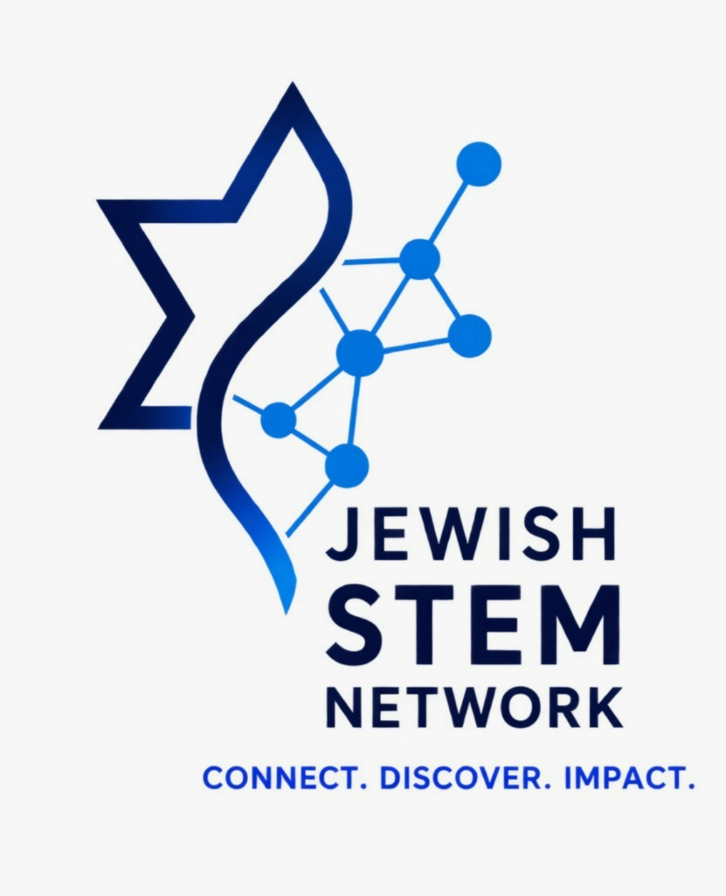
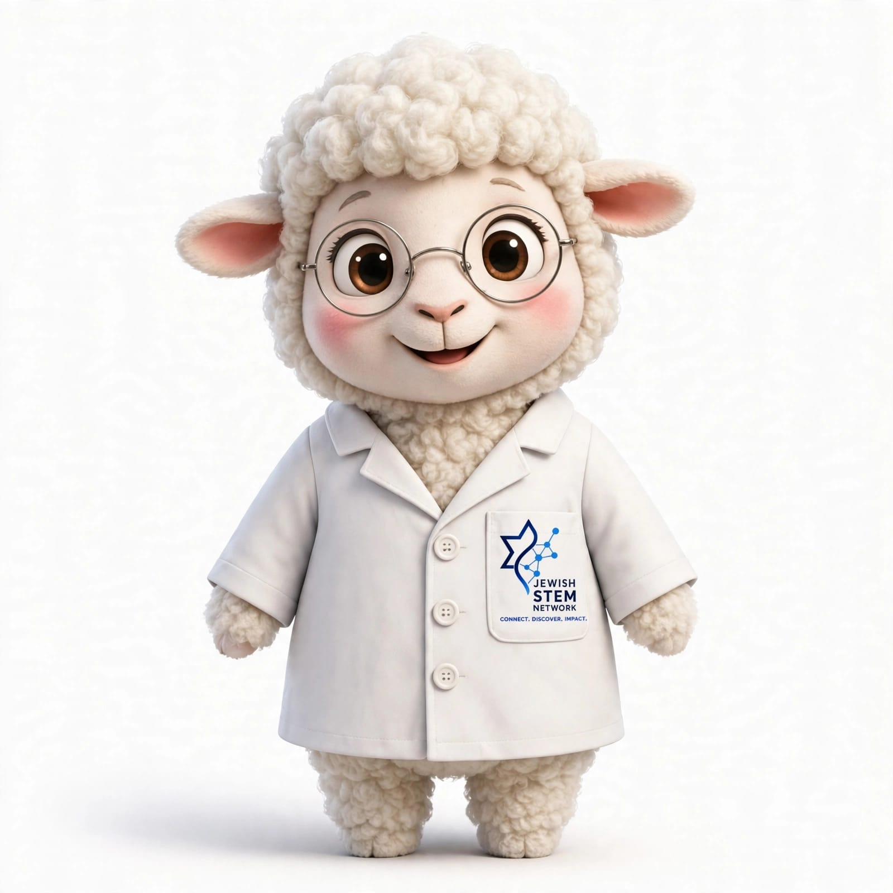

# Jewish STEM Network
### Connect. Discover. Impact.

## 👋 Hi, we're the JSN!

We're a global, welcoming community of **Jewish university students and young professionals (18–35)** working in or curious about **science, technology, engineering and math**.

Whether you're a first-year biology student, a software engineer, a PhD researcher or just STEM-curious, there's a place for you here.

## 🐑 Meet DiNA

DiNA is our lab-coat-wearing mascot and your guide to the network. She loves experiments, good questions and new friends.

## 🧬 What we do
- 🤝 **Connect**: a worldwide network of peers and mentors
- 🔭 **Discover**: opportunities, resources and ideas across STEM
- 🚀 **Impact**: collaborative projects and a community that supports each other

## 🌍 Get involved
- 💬 Join our community: write to us at jewishstemnetwork@gmail.com
- 💡 Have an idea? Open an issue or start a discussion in our repos
- 🛠️ Want to contribute? Anyone is welcome, no experience required. Start from our `good first issue` tags.

*Built by the community, for the community.* ✡️
